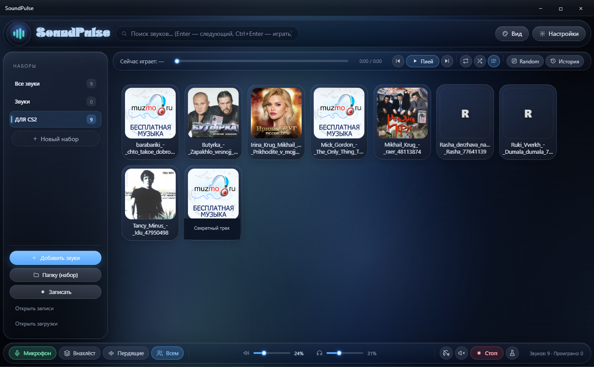

<div align="center">



# SoundPulse

**Бесплатная open-source звуковая пушка для Windows.**
Аналог Soundpad — только бесплатно и с открытым кодом.

[](#требования)
[](https://github.com/MADE-IN-DEEPSEEK/SoundPulse/releases/latest)
[](LICENSE)
[](https://www.electronjs.org/)

[**⬇ Скачать установщик**](https://github.com/MADE-IN-DEEPSEEK/SoundPulse/releases/latest) ·
[Как установить](#установка) ·
[Почему антивирус ругается](#это-не-вирус-и-вот-почему) ·
[Собрать самому](#запуск-из-исходников)

</div>

---

## Что это

SoundPulse проигрывает музыку, мемы и любые звуки в **микрофон, который видит игра или голосовой чат**. В игре достаточно выбрать виртуальный кабель (VB-CABLE, SteelSeries Sonar, VoiceMeeter) — и тима слышит то, что играешь ты.

Это **бесплатный аналог Soundpad** с открытым исходным кодом: без подписки, без лимита звуков, без рекламы и без телеметрии. Платить не за что — весь код лежит здесь.

> Проект сделан человеком вместе с ИИ — **DeepSeek V4.1 Flash** (через OpenCode). Код, интерфейс и тексты писались в паре: человек ставил задачи и проверял результат, ИИ писал и правил код.

## Первый запуск

<div align="center">

</div>

При первом запуске SoundPulse проводит за руку: мастер настройки за 4 шага подскажет, как подключить виртуальный микрофон, а обучение из 3 модулей покажет каждую кнопку на коротких видео. Прошёл один раз — больше не появляется, даже после перезапуска Windows. Захотел повторить — **Настройки → Мастер настройки → «Пройти заново»**.

## Возможности

| | |
|---|---|
| 🎵 **Библиотека и наборы** | Сколько угодно звуков, папки-наборы, перетаскивание файлов, поиск |
| 🎙 **Запись с микрофона** | Записать голос или системный звук прямо в библиотеку |
| 🔊 **Куда играть** | Виртуальный микрофон, свои динамики или сразу и туда, и туда |
| ⌨️ **Горячие клавиши** | Любая комбинация на звук, индекс-хоткеи `Ctrl+Alt+1…0`, push-to-talk |
| 🎚 **Bass-эффект** | Пять режимов: Обычные → Бас → Жесть → Кнопочный → **425 БАЗА** |
| 🗣 **Работа с голосом** | Микширование голоса, шумовые ворота, дакинг, нормализация |
| 🔀 **Плеер** | Внахлёст, очередь, Random, история, перемотка, громкость |
| 🧭 **Первый запуск** | Мастер настройки за 4 шага и обучение с 19 видео |
| 🖥 **Трей и автозапуск** | Свернул и не мешает; можно стартовать вместе с Windows |

## Это не вирус, и вот почему

Первое, что видит человек: SmartScreen пишет «Windows защитила ваш компьютер», а антивирус может ругнуться. **Это нормальная реакция на новый неподписанный exe**, а не признак заразы. Вот вся правда:

- **Нет сертификата подписи кода.** Он стоит от 120$ в год. Без него Windows обязана показывать предупреждение для любого нового файла — даже для безобидной программы на 10 строк. Подпись ≠ безопасность, её отсутствие ≠ вирус.
- **Приложение новое и малоизвестное.** SmartScreen и антивирусы смотрят на «репутацию»: сколько людей скачали и не пожаловались. У свежего файла репутации ноль, поэтому эвристика перестраховывается.
- **Программа ставит глобальный хук клавиатуры.** Это нужно, чтобы ловить горячие клавиши, когда окно свёрнуто. Такой же механизм используют игры, оверлеи и макросы — и антивирусы его не любят. Хук видит только нажатия клавиш, не содержимое экрана и не пароли.
- **Внутри два вспомогательных exe** (`sp_keyhook.exe`, `ptt_inject.exe`) — они собираются из исходников в `build/helpers/*.cs`, которые тоже лежат в репозитории. Можешь проверить или пересобрать.
- **Никакой телеметрии, аналитики и автообновлений.** Приложение не отправляет ничего о тебе. В интернет ходит только когда **ты сам** вставляешь ссылку на звук или нажимаешь кнопку «Скачать VB-CABLE».
- **Код открыт.** Любой может прочитать, что делает программа, и собрать её самому — тогда антивирус будет ругаться только на твою сборку.

**Что делать, если скачал:**
1. SmartScreen → «Подробнее» → «Выполнить всё равно».
2. Антивирус ругается → добавь файл в исключения или собери из исходников.
3. Хочешь проверить — залей exe на [VirusTotal](https://www.virustotal.com/). Несколько «эвристических» срабатываний на неподписанный установщик — обычное дело; десятки — повод не запускать.

Мы не обижаемся, если ты перестрахуешься: собирай сам, весь код перед тобой.

## Установка

1. Открой [последний релиз](https://github.com/MADE-IN-DEEPSEEK/SoundPulse/releases/latest) и скачай **`SoundPulse Setup 2.0.0.exe`**.
2. Запусти установщик. Права администратора не нужны, ставится в профиль пользователя.
3. Пройди мастер настройки: он подскажет, как подключить виртуальный микрофон.

Обновлять данные не придётся: настройки и библиотека лежат отдельно и переживают переустановку.

## Требования

- Windows 10 или 11, **x64**.
- Для звука в игру/чат — виртуальный аудиокабель: [VB-CABLE](https://vb-audio.com/Cable/) (бесплатно), SteelSeries Sonar или VoiceMeeter.
- Если звук нужен только в своих наушниках — ничего дополнительно не нужно.

## Запуск из исходников

Нужен Node.js 20+ и npm.

```bash
git clone https://github.com/MADE-IN-DEEPSEEK/SoundPulse.git
cd SoundPulse
npm install
npm start
```

Сборка установщика:

```bash
npm run dist
```

Результат: `dist/SoundPulse Setup 2.0.0.exe`. Быстрая сборка без установщика: `npm run pack` → `dist/win-unpacked/`.

## Стек

- **Electron 43** — окно, трей, хоткеи, IPC.
- **Чистый JavaScript / HTML / CSS** — без фреймворков и сборщиков.
- **Web Audio API** — микширование, дакинг, ворота, bass-цепочка, маршрутизация через `setSinkId()`.
- **NSIS + electron-builder** — установщик.

## Структура

```
soundpulse/
в”њв”Ђ build/
│  ├─ icon.ico              иконка приложения и установщика
│  ├─ installer.nsh         текст и настройки NSIS
│  └─ helpers/              исходники и собранные exe (хук клавиатуры, PTT)
в”њв”Ђ src/
│  ├─ main.js               главный процесс: окно, трей, хоткеи, IPC
в”‚  в”њв”Ђ preload.js            РјРѕСЃС‚ contextBridge в†’ window.soundpad
в”‚  в””в”Ђ renderer/
│     ├─ index.html         разметка
│     ├─ style.css          оформление
│     ├─ app.js             интерфейс и логика
│     ├─ audio.js           звуковой движок
в”‚     в”њв”Ђ worklet-recorder.js
в”‚     в”њв”Ђ fonts/
│     ├─ ui/                звуки интерфейса
│     └─ media/onboarding/  ролики обучения
в””в”Ђ package.json
```

## Где лежат данные

`%APPDATA%\SoundPulse\`

| Файл | Что внутри |
|---|---|
| `settings.json` | настройки: устройства, хоткеи, громкости |
| `library.json` | библиотека звуков и наборы |
| `debug.log` | лог приложения |

Записи и скачанные звуки: `%USERPROFILE%\Documents\SoundPulse\recordings` и `\downloads`.
При удалении приложения эти файлы **не** стираются.

## Как устроен звук

Два независимых `AudioContext`:

- **spk** — в динамики (слышишь ты), громкость `monitorVol`;
- **mic** — в виртуальный кабель через `setSinkId()`, громкость `masterVolume`.

Цепочка в каждом: `master → WaveShaper → lowshelf → atten → analyser → destination`.
Своего виртуального микрофона приложение не создаёт: оно играет звук в выбранное устройство, а в игре это устройство выбирается как микрофон.

## FAQ

**Это правда бесплатно?**
Да. MIT-лицензия, никаких подписок и «премиум»-ограничений.

**Чем отличается от Soundpad?**
Soundpad платный и закрытый. SoundPulse бесплатный, с открытым кодом, русским интерфейсом, наборами звуков и bass-режимом «425 БАЗА».

**Почему антивирус ругается?**
Смотри раздел [«Это не вирус»](#это-не-вирус-и-вот-почему). Коротко: нет платной подписи + глобальный хук клавиатуры.

**Обучение будет всплывать каждый раз?**
Нет. Прошёл один раз — больше не появляется ни после перезапуска приложения, ни после перезапуска Windows. Повторить можно вручную: **Настройки → Мастер настройки → «Пройти заново»**.

**РљСѓРґР° СѓС…РѕРґРёС‚ Р·РІСѓРє РІ РёРіСЂРµ?**
В виртуальный кабель (VB-CABLE и аналоги). В настройках игры выбери это устройство как микрофон.

**Можно использовать в голосовом чате?**
Да, механизм тот же: приложение играет в виртуальный микрофон, чат его слушает.

## Статус проекта и известные ограничения

Проект молодой и живой, поэтому **баги возможны — и это нормально**. Если что-то сломалось, не работает или выглядит странно, напиши в [Issues](https://github.com/MADE-IN-DEEPSEEK/SoundPulse/issues) — починим.

Что стоит знать заранее:

- **Анимации местами могут дёргаться** — особенно на слабых ПК, при большом числе карточек или во время воспроизведения видео в обучении. Это не поломка, а неоптимизированные переходы.
- **Обучение и мастер настройки** — самая свежая часть, в ней вероятнее всего встретить шероховатости в вёрстке или текстах.
- **Редкие аудиоустройства** могут определяться не с первого раза: если виртуальный кабель не видно, перезапусти приложение или переподключи устройство.
- **Горячие клавиши** могут конфликтовать с другими программами, которые тоже ставят глобальный хук; в таком случае поменяй комбинацию или отключи конфликтующую программу.
- **Большая библиотека** (сотни звуков) может подтормаживать при первом открытии набора — обложки догружаются лениво.
- **Приложение не подписано**, поэтому SmartScreen ругается (см. раздел выше).
- На неподдерживаемых конфигурациях (Windows 10 старых сборок, нестандартные DPI) возможны визуальные огрехи.

Всё это лечится фидбеком: чем больше отчётов, тем быстрее проект становится стабильным.

## Лицензия

[MIT](LICENSE) — используй, меняй, распространяй, собирай свои сборки. Единственное условие: сохранить текст лицензии.

<div align="center">

Сделано с любовью к мемам и громким басам.

</div>
